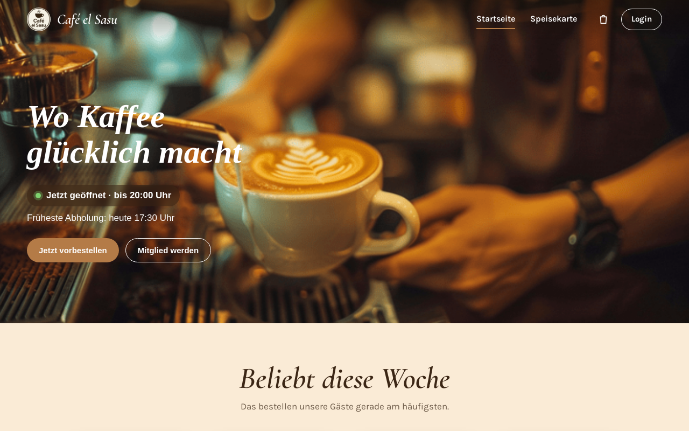
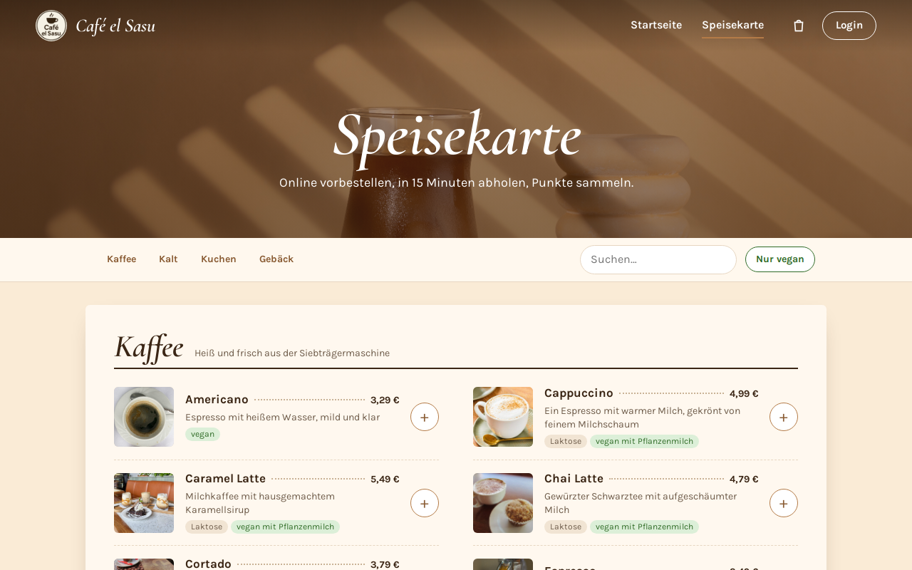
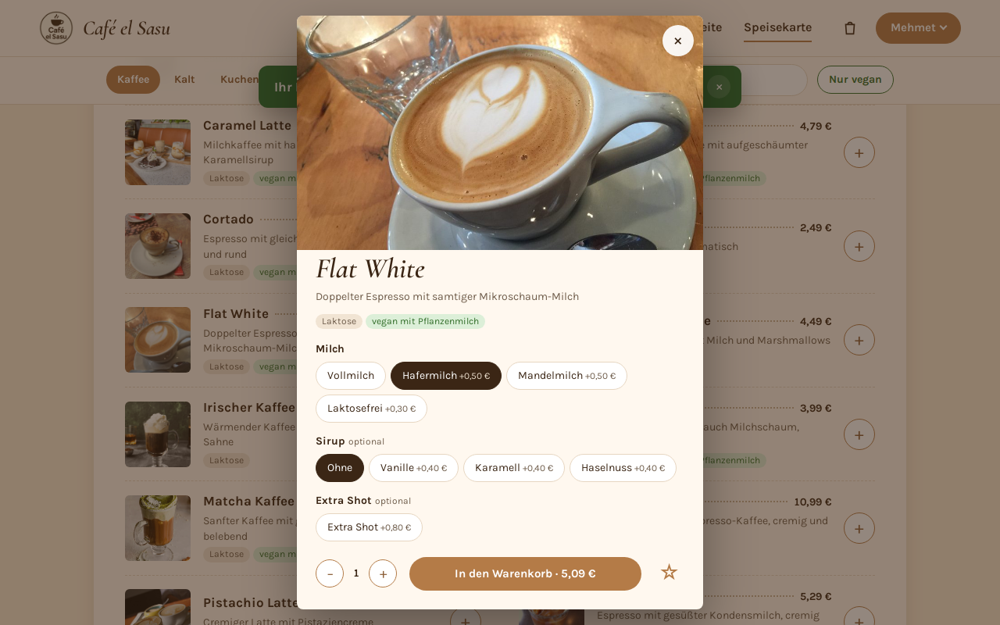
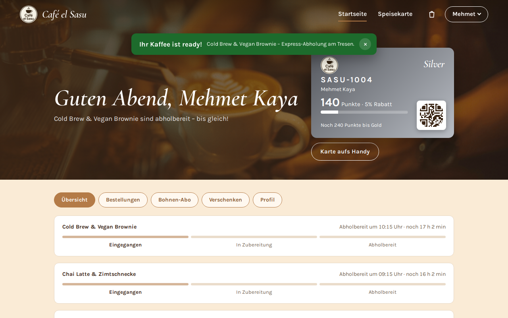
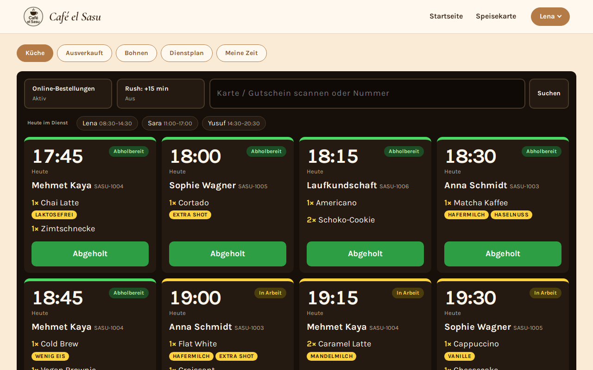
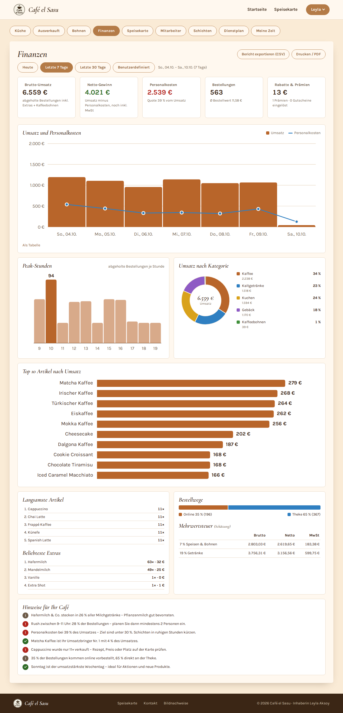
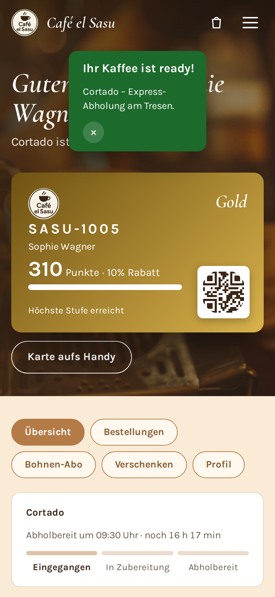

# Café el Sasu — Online Preorder & Café Management

**Order ahead, skip the line.** A full-stack web app for a real café in Krefeld, Germany. Guests preorder coffee and cake for pickup and collect loyalty points. The team runs a live kitchen display and tracks their hours. The owner gets a finance dashboard with revenue, labor cost and VAT.




> The interface is in German (formal *Sie*), like the café itself. This README is in English.

---

## Highlights

- **Three apps in one.** A single-page app serves guests, staff and the owner. One login decides where each person lands, and every route is protected on the server.
- **Real business rules.** Pickup slots respect opening hours (Europe/Berlin, including daylight-saving changes), kitchen capacity per 15-minute window, sold-out items and rush mode.
- **Money done right.** All amounts are integer cents. Prices are recalculated on the server, discounts are split across lines with a largest-remainder method, and the dashboard's daily totals add up exactly to its KPIs.
- **Security built in.** Passwords are hashed with scrypt, sessions use HttpOnly cookies, login attempts are throttled, and there is a strict Content-Security-Policy, CSRF protection and CSV-injection guards.
- **Small footprint.** There is no framework and no build step. The app has two runtime dependencies (`express`, `qrcode`) and uses Node's built-in SQLite.

## Screenshots

| Speisekarte | Drink options with live price |
|---|---|
|  |  |
| **Member account with live order status** | **Kitchen display for staff** |
|  |  |

<details>
<summary><b>Finanzen dashboard (owner)</b> and mobile view</summary>

| Finanzen | Mobile |
|---|---|
|  |  |

</details>

## Features

### For guests
- **Preordering.** The menu has 49 items with photos, search, allergen and vegan filters, and options such as milk, syrup, extra shot and ice level. Prices update live as options change.
- **Pickup slots.** Guests pick a valid 15-minute window. Full windows show as *Ausgebucht*, and the capacity check runs inside the same database transaction as the order.
- **Live order status.** A progress bar runs from *Eingegangen* to *In Zubereitung* to *Abholbereit*. An "Ihr Kaffee ist ready!" banner appears on every page.
- **Loyalty program.** Guests earn 1 point per euro and move through the tiers Bronze, Silver (5 % off) and Gold (10 % off). Rewards include a free pastry, coffee or cake, plus a birthday-week coffee. A single *Prämien-Strecke* track shows the progress.
- **Member card.** Each card has a QR code to scan at the counter and can be saved as an image for the phone ("Karte aufs Handy"). The site also installs as a home-screen web app.
- **Speed dial.** *Das Übliche* reorders a guest's usual drink in one tap. Guests can also save customised favourites and set a preferred milk.
- **Bean subscription.** Guests reserve whole beans every 1, 2 or 4 weeks, and can pause, skip or cancel.
- **Coffee gifts.** A guest can gift a coffee, paid with points or at the counter. The gift is shared via WhatsApp or e-mail as a link with a QR code.

### For staff
- **Kitchen display.** It has a high-contrast ticket grid with big pickup times and option badges. One tap moves a ticket to the next status.
- **Rush controls.** Staff can pause online orders, add 15 minutes of lead time, or mark items as sold out.
- **Member lookup.** Staff scan the guest's QR code with the camera (BarcodeDetector) or a USB scanner, or type the member number.
- **Meine Zeit.** Staff clock in and out with breaks, get legal-break reminders, and see their net hours, earnings, a 14-day chart and their full history.
- **Dienstplan.** A weekly rota shows who is on shift today.

### For the owner
- **Finanzen.** The dashboard covers today, 7 days, 30 days or a custom range.
  - KPI cards show gross revenue, result after labor, labor cost ratio, order count and average ticket, and discounts.
  - SVG charts with tooltips and a table view show revenue vs. labor, peak hours, a category donut and the top 10 items.
  - Further panels cover slowest items, popular extras, online vs. walk-in orders, a VAT estimate (7 % / 19 %) and rules-based business tips.
  - Reports export as CSV for Excel, or as a print-ready PDF layout.
- **Menu editor.** The owner can edit prices, descriptions, tags and photos, and hide or delete items. Old receipts keep their original prices.
- **Team management.** The owner creates staff accounts with temporary passwords, sets hourly wages, deactivates accounts and plans shifts.
- **Payroll export.** A monthly CSV lists each person's net hours and wages.

## Architecture

```
Browser (vanilla ES modules, hash router)          Server (Node 22 + Express)
┌──────────────────────────────────────┐   JSON   ┌───────────────────────────────┐
│ index.html  – one <template> per view│ ───────► │ app.js   routes, auth, roles  │
│ router.js   – guards, per-mount life │          │ rules.js pure business rules  │
│ views/*.js  – home, menu, cart,      │ ◄─────── │ db.js    schema + migrations  │
│               account, admin, finance│          │ seed.js  realistic demo data  │
└──────────────────────────────────────┘          └──────────────┬────────────────┘
                                                                 │ node:sqlite
                                                           data/cafe.db
```

**Design decisions**
- **Pure rules module.** Pricing, tiers, opening hours, pickup validation, break rules, VAT and insights live in `server/rules.js` as pure functions. Tests cover them directly, and the routes stay thin.
- **Server-side trust.** The client never sends prices, only item IDs and options. The server re-validates options, copies prices onto each order line, and enforces every role check.
- **Transactions where it matters.** The capacity check and order insert run in one `BEGIN IMMEDIATE` transaction, so two guests can't take the last slot.
- **Time zones on purpose.** Every slot, report bucket and shift is calculated in `Europe/Berlin`, so the 23- and 25-hour days at the daylight-saving switches are handled correctly.
- **Schema migrations.** `db.js` adds new columns and indexes to existing databases at startup, and backfills data such as usernames.

## Security

- Passwords are hashed with scrypt (at least 8 characters). Staff and admin passwords come from environment variables or are generated randomly, never hard-coded.
- Session cookies are HttpOnly and SameSite=Lax, and Secure in production. A password change signs out other devices.
- After 5 failed logins per account or 20 per IP, login pauses for 15 minutes.
- Every write request needs a JSON content type and a same-origin request (CSRF protection).
- The strict Content-Security-Policy allows only the site's own scripts. Responses also send `X-Frame-Options: DENY`, `nosniff` and a strict referrer policy.
- All SQL is parameterised and all user text is escaped before rendering. CSV exports guard against formula injection.

## Getting started

Requires **Node.js 22.13+**.

```bash
git clone https://github.com/toumiamine12/cafe-el-sasu.git
cd cafe-el-sasu
npm install
ADMIN_PASSWORD=admin123 STAFF_PASSWORD=staff123 npm start   # http://localhost:3000
npm test                                                     # 122 API, rules and DB tests
```

On first start, the app creates `data/cafe.db` and fills it with demo data: a month of order history, today's service with orders in every status, 7 staff members with shifts and a rota, and 5 bean subscriptions. Delete `data/` to reset it.

### Demo logins

| Role | Login | Password |
|---|---|---|
| Guest | `SASU-1004` or `mehmet@example.com` | `demo123` |
| Owner (Leyla Aksoy) | `SASU-1000` | value of `ADMIN_PASSWORD` |
| Staff | `SASU-1001`, `SASU-1002`, `SASU-1007` … `SASU-1011` | value of `STAFF_PASSWORD` |

Every account also has a username in the form `vorname.nachname` plus 4 digits, which works for login too. The staff and admin usernames are printed in the terminal on first start. If no passwords are set, random ones are generated and printed once.

## Deployment

The repo includes a [Render](https://render.com) blueprint (`render.yaml`):

1. On Render, choose **New → Blueprint** and select this repository.
2. Render generates `ADMIN_PASSWORD` and `STAFF_PASSWORD`. You can find them under *Environment*.

The free plan has no persistent disk, so the demo data resets on each restart. A production setup needs a persistent disk or a hosted database.

## Project structure

```
server.js              entry point
server/app.js          Express routes: auth, orders, loyalty, staff, analytics
server/rules.js        pure business rules (pricing, hours, tiers, VAT, insights)
server/db.js           schema, migrations, password hashing, transactions
server/seed.js         demo menu, users, history, today's service
public/index.html      app shell + one <template> per view
public/router.js       hash router with route guards
public/app.js          shared helpers: API client, session, cart, navbar
public/views/          one module per view (menu, cart, account, admin, finance, …)
public/shop.css        all styles
test/                  node:test suites (rules, API, database)
```

## Roadmap

- Online payment (Stripe) and e-mail order confirmations
- Push notifications when an order is ready
- Apple / Google Wallet passes for the member card
- PostgreSQL for multi-instance hosting

## Credits

The menu photos come from Wikimedia Commons and Flickr under Creative Commons licenses, and each is credited on the in-app *Bildnachweise* page. All other photos and the logo belong to Café el Sasu.

Built by [toumiamine12](https://github.com/toumiamine12).
